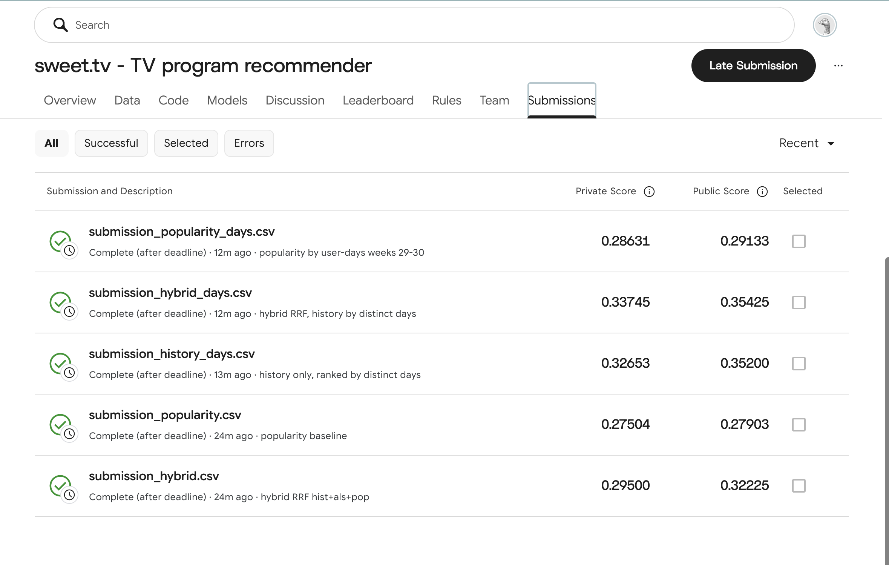

# Recommending sweet.tv TV Programmes from Viewing Logs: Popularity, History, ALS and Their Hybrid

**Author:** [First Name Last Name]  ·  **Date:** 2026-10-24

**Competition:** Kaggle `sweettv-tv-program-recommender` [4]  ·  **Code:** https://github.com/Qwidji/sweettv-recsys

## Abstract

This work addresses the sweet.tv Kaggle competition: given a TV viewing log of 4,914 users over ISO weeks 11–30 of 2020 and the broadcast schedule, the task is to predict 5 programmes for each of 1,260 users for weeks 31–42, evaluated by MAP@5. The log is converted into user–programme interactions by intersecting viewing intervals with broadcast intervals, using a 300-second threshold. Under temporal validation (training on weeks 11–20, testing on weeks 21–30) we compare popularity, user history, ALS for implicit feedback, a TF-IDF content-based model, and a hybrid based on weighted reciprocal rank fusion. The best result is obtained by the hybrid in which history is ranked by the number of distinct viewing days: MAP@5 of 0.686 on validation and 0.354 / 0.337 public / private score on Kaggle (late submission). Replacing total viewing time with the number of days improved results both on validation and on Kaggle.

## 1. Introduction

The operator sweet.tv provided a viewing log of linear TV channels and an archive of the TV schedule. For each of the 1,260 users in `submission.csv`, the task is to output 5 programme identifiers (`tv_show_id`) that the user will watch in the next period; quality is measured by MAP@5 [4].

Properties of the task that shaped the solution:

- **The log contains no programmes.** It records the channel (`vsetv_id`) and the viewing interval; the programme can only be recovered by matching against the broadcast schedule.
- **Programme labels are incomplete.** About 89% of schedule rows have `tv_show_id = 0`, i.e. the programme is unlabelled.
- **Only programmes that will be broadcast can be recommended.** The candidate pool is defined by the schedule of the future period: the final pool contains 6,636 programmes, of which only 3,073 appear in the training data.
- **Repeat viewing is the norm.** Users watch the same news and recurring programmes, so recommending already watched programmes is allowed.

Contributions:

- a reproducible pipeline from raw logs to submission: `src/join.py`, `src/eval.py`, `src/predict.py`;
- a single temporal validation protocol for five families of methods;
- the observation that, for user history, regularity (the number of distinct viewing days) matters more than total viewing time.

## 2. Related Work

**Implicit feedback.** Hu, Koren and Volinsky [1] proposed matrix factorization for implicit feedback: observed quantities such as viewing time are turned into a binary preference and a confidence weight, and the model is trained by alternating least squares (ALS). Their experiments were conducted on digital television viewing data. We use the ALS implementation from the `implicit` library [3]. The interaction weight is a logarithm of viewing time, similar in spirit to the logarithmic confidence scaling in [1].

**Content-based recommendation.** Lops, de Gemmis and Semeraro [2] describe content-based recommender systems: a user profile is built from the features of consumed items, and candidates are ranked by similarity to the profile; a standard representation is TF-IDF vectors with cosine similarity. Our content model follows this scheme using schedule metadata: category, genres, director and actors.

## 3. Method

### 3.1 Data and Interaction Construction

| File | Rows | Contents |
|---|---|---|
| `dataset11-30.csv` | 5,821,987 | `user_id, vsetv_id, start_time, stop_time, duraton` |
| `export_arh_11-20/21-30/31-42-final.csv` | 1,074,235 / 1,074,394 / 1,295,378 | schedule: channel, start, duration, `tv_show_id`, category, genres, director, actors |
| `submission.csv` | 1,260 | `user_id`, 5 space-separated ids |

- **Time coverage.** The log covers 2020-03-09 – 2020-07-26 (ISO weeks 11–30). The numbers in the schedule file names correspond to ISO weeks; the 31-42 schedule runs until 2020-10-19.
- **Time formats differ:** `%Y-%m-%d %H:%M:%S` in the log, `%d.%m.%Y %H:%M:%S` in the schedule.
- **Channels.** Of the 202 channels in the log, 197 are present in the schedule; they account for 98.05% of log rows.
- **Test users.** All 1,260 are present in the log.

**Matching** (`src/join.py`):

1. The three schedule files are concatenated; the programme end is computed as `start + duration`.
2. Duplicates by `(channel_id, start_time)` are removed (1 found).
3. Log rows on channels absent from the schedule are dropped (113,579 rows, 1.95%).
4. For each viewing, overlapping programmes on the same channel are found: programmes are sorted by the key "channel·10¹⁰ + time", the range boundaries are located by two binary searches, and the left boundary uses the running maximum of programme ends so that overlapping programmes are not lost. No Cartesian product is formed.
5. For each pair, `overlap = min(stop, end) − max(start, prog_start)` is computed.

A pair with overlap ≥ 300 s counts as a "view". There are 4,610,846 such pairs, of which 51.6% fall on labelled programmes. Only these are stored in `interactions.parquet`: 2,378,699 rows, 4,890 users, 4,272 programmes. The median overlap in these data is 1,193 s.

**Time zone check.** On 200,000 random viewings, we measured the share of starts within ±60 s of the start of any programme when shifting the schedule by −3…+3 h. The maximum is at zero shift (0.0357), but at +1…+3 h the share is almost the same (0.0351–0.0355), so the check only fails to contradict the absence of a shift. The schedule was not adjusted.

### 3.2 Methods

All methods produce a ranked list from the candidate pool. If there are fewer than five candidates or the user has no history, the list is padded with popular programmes. Repeats are allowed.

- **Popularity.** Pool programmes are ranked by the number of unique viewers in the training data, either over all weeks or over the last two.
  - *Popularity-days variant:* ranking by the number of distinct (user, day) pairs.
- **History.** Pool programmes the user has already watched are ranked by total overlap.
  - *History-days variant:* ranking by the number of distinct calendar days of viewing, ties broken by overlap.
- **ALS** [1, 3]. A user × programme matrix with weight `log1p(Σ overlap_sec / 60)`, 20 iterations, `random_state = 42`. Grid: factors ∈ {32, 64}, regularization ∈ {0.01, 0.1}. Scores are dot products of factors over pool programmes present in training; already watched programmes are not filtered.
- **Content** [2]. Each programme is mapped to a document of `cat=`, `genre=`, `dir=`, `act=` tokens, vectorized with TF-IDF and L2 normalization. The user profile is the weighted mean of the vectors of watched programmes (weights as in ALS). Candidates are ranked by cosine similarity.
- **Hybrid.** A weighted variant of reciprocal rank fusion [5] over three lists (top-50 of each method): `score(i) = Σ_m w_m / (k0 + rank_m(i))`, where m ∈ {History, ALS, Popularity}.
  - Grid: w_hist = 1 (the scale of the weights does not affect the order), w_als ∈ {0.25, 0.5, 1, 2, 4}, w_pop ∈ {0, 0.1, 0.25, 0.5}, k0 ∈ {10, 60}, 40 configurations in total.
  - *Hybrid-days variant:* the same best configuration, with History-days instead of History.

## 4. Experiments

### 4.1 Protocol

**Validation** (`src/eval.py`):

- **Split:** training on weeks 11–20 (562,815 user–programme pairs, 4,833 users), testing on weeks 21–30.
- **Pool:** `tv_show_id ≠ 0` from the 21-30 schedule, 6,363 programmes, of which 2,154 appear in training.
- **Ground truth:** the set of programmes the user watched in weeks 21–30; 99.98% of truth pairs lie in the pool.
- **Evaluated users:** 4,799 with non-empty truth, of whom 57 have no training history. The subset of 1,246 test users is reported separately.
- **Metric:** MAP@5 with denominator min(5, |truth|); the implementation is covered by a unit test on five hand-computed examples.

**Final submissions** (`src/predict.py`):

- training on weeks 11–30 (934,181 pairs);
- pool from the 31-42 schedule (6,636 programmes, 3,073 of which appear in training);
- popularity over weeks 29–30; the two test users without history receive popular programmes;
- each file is checked: 1,260 rows in template order, exactly 5 distinct non-zero ids from the pool;
- all submissions were made as **late submissions**: the competition closed on 2020-11-21. Kaggle returns public and private scores, but they do not appear on the leaderboard;
- the final (designated) submission is `submission_hybrid_days.csv`, private 0.33745.

**Environment:** Python 3.13.5, numpy 2.5.3, pandas 3.0.6, scipy 1.18.1, scikit-learn 1.9.1, implicit 0.7.3; Apple M1, 8 CPU, 8 GB RAM. Seed = 42.

### 4.2 Results

**Table 1.** MAP@5 on validation and on Kaggle. Time covers training and prediction on validation.

| Method | Parameters | Valid, all | Valid, test | Kaggle public | Kaggle private | Time, s |
|---|---|---|---|---|---|---|
| Popularity | unique viewers, wk 11–20 | 0.61945 | 0.73167 | — | — | 0.1 |
| Popularity | unique viewers, wk 19–20 (Kaggle: 29–30) | 0.62279 | 0.73417 | 0.27903 | 0.27504 | 0.0 |
| Popularity-days | (user, day) pairs, wk 19–20 (29–30) | 0.61945 | 0.73167 | 0.29133 | 0.28631 | 0.0 |
| History | by overlap | 0.56280 | 0.67345 | — | — | 0.2 |
| History-days | by number of days | 0.65310 | 0.76823 | 0.35200 | 0.32653 | 0.4 |
| ALS | f=32, reg=0.01 | 0.48842 | 0.54516 | — | — | 1.6 |
| ALS | f=32, reg=0.1 | 0.48941 | 0.54618 | — | — | 1.5 |
| ALS | f=64, reg=0.01 | 0.41814 | 0.45097 | — | — | 2.6 |
| ALS | f=64, reg=0.1 | 0.41907 | 0.45197 | — | — | 2.6 |
| Content | TF-IDF | 0.17469 | 0.19350 | — | — | 4.4 |
| Hybrid | k0=10, w_als=0.5, w_pop=0.5 | 0.65976 | 0.77418 | 0.32225 | 0.29500 | 4.2 (grid) |
| **Hybrid-days** | same weights, History-days | **0.68553** | **0.79766** | **0.35425** | **0.33745** | 0.1 |

**Observations:**

1. **Popularity is a strong baseline.** On validation it outperforms History, ALS and Content individually.
2. **ALS:** 32 factors are better than 64 for both regularization values; regularization has almost no effect.
3. **Hybrid.** All five best Hybrid configurations have w_pop = 0.5, i.e. the optimum lies on the grid boundary. The ALS weight in the best configuration is 0.5; with w_als = 1, MAP@5 over all users drops to 0.65409.
4. **Switching to the number of days** improves History (0.563 → 0.653) and the hybrid (0.660 → 0.686) on validation. The order is the same on Kaggle: Hybrid-days 0.354 / 0.337 versus 0.322 / 0.295 for Hybrid. History-days without ALS and popularity (0.352 / 0.327) also beats the original Hybrid.
5. **Popularity-days on validation** matches Popularity over weeks 11–20 to the fifth decimal place: their top-5 lists are identical. On Kaggle it is slightly better than plain popularity.
6. **Kaggle scores are much lower than validation for all methods:** Hybrid-days scores 0.798 on validation test users versus 0.354 public; popularity 0.734 versus 0.279. The best ALS and the hybrid weights were selected on the same validation, so their validation scores are optimistic.

*Figure 1. Kaggle: all submissions are late submissions (the competition closed on 2020-11-21); scores are returned by Kaggle but do not appear on the leaderboard. The final (designated) submission is submission_hybrid_days.csv, private 0.33745.*

### 4.3 Examples

For a heavy test user (6,015 interactions, 634 programmes in training) and a light one (1 interaction), we print the top-5 of each method (full tables in `results.md`).

| Method | AP@5, heavy | Already watched (of 5), heavy | AP@5, light | Already watched (of 5), light |
|---|---|---|---|---|
| Popularity | 1.0000 | 5 | 0.1000 | 0 |
| History-days | 1.0000 | 5 | 0.0667 | 1 |
| ALS | 0.0000 | 4 | 0.0000 | 1 |
| Content | 0.1000 | 3 | 0.0000 | 1 |
| Hybrid-days | 1.0000 | 5 | 0.0500 | 1 |

**Heavy user.** Popularity, History-days and Hybrid-days return news and recurring programmes ("TSN", "Fakty. Utro", "Segodnya"); all five are in the user's truth. ALS suggests films and entertainment programmes that the user watched in training but not in validation.

**Light user.** All methods except Popularity put the only watched film first. It is not in the truth, so the single hit ("Fakty. Utro") moves down the list.

## 5. Discussion

**Error case.** When running eval.py for the first time, ALS crashed: the values from build_matrix were unpacked in a different order, and the user IDs were assigned to the variable iids. Cause: The function returns (m, uids, iids, u_idx, i_idx), but when the function was called, the order was reversed. After fixing the error, I verified the results using a separate script, check_als.py: all 5 ALS recommendations for user 4537998735244442792 were present in the list of programs, and AP@5 = 0.5433 matched my manual calculation (hit rate at positions 2–5: (1/2 + 2/3 + 3/4 + 4/5) / 5).

**What worked.**

Movie viewing frequency proved to be the strongest signal. Ranking historical data by different numbers of days yielded a score of 0.653 on the validation dataset, compared to 0.563 when ranked by total time. These results were confirmed on Kaggle: 0.327 on the private dataset versus 0.295. It appears that longer movies attract more viewing seconds but are not rewatched, while shorter news segments are watched daily and replayed.

The hybrid model (RRF based on daily history, ALS, and popularity) yielded the best results both on the validation dataset (0.686) and on Kaggle (private dataset: 0.337). The ranking of the methods on the validation dataset and on Kaggle matches, so I believe validation is useful for model selection, even though the absolute values differ significantly.

**Surprising or ineffective findings.**

Popularity (0.623) proved to be stronger than both ALS (0.489) and historical data based on overlap. I think the reason is that the actual user data is very extensive: an average of about 97 programs over 10 weeks, and popular news stories almost always appear in that data.

The content-based method only achieved 0.175. Genre and actors do not explain why users tune in to TSN every night.

The gap between the valid results (0.69) and the Kaggle results (0.34) is the same for all methods, including popularity, which means the issue isn’t just about weight selection. We don’t know how Kaggle defines “views” in the test, and I couldn’t verify this either.

For users who watch very little (1 movie in the training set), all personalization methods rank this movie first, and the popularity method performs better (AP 0.10 vs. ≤ 0.067). This is just one example, not a general conclusion.

**Limitations.**

Only about 11% of the lines in the TV schedule have a program ID; the rest were discarded, even though the marked programs accounted for 51.6% of views longer than 5 minutes.

The time zone check is weak: the match rate remains virtually unchanged when shifting from −3 to +3 hours (3.2–3.6%). I kept the shift at 0 because that is the maximum value and manual checks seemed reasonable, but I do not consider this conclusive evidence.

“Daily” variations appeared after the first submission on Kaggle. I subsequently tested them on the validation dataset, but this idea originated from the Kaggle leaderboard. The weight coefficients of the hybrid model were adjusted based on that very validation dataset, so the score of 0.686 was overly optimistic.

All submissions were late. Kaggle returned scores, but they were not included in the leaderboard.

**Next improvement:** Split the validation dataset into two parts: in the first part, determine the “viewing time” threshold (currently 300 seconds) and the hybrid model’s weights; in the second part, evaluate them objectively.

## 6. Disclosure of AI Use

**Tools:** Claude Code — full source code, running experiments, submitting entries via the Kaggle CLI, report drafts, and formatting. Claude (app, Cowork mode) — planning prompts for Claude Code.

**How AI was used:** generating code, debugging, presenting reports, and discussing how to interpret results.

**What I have verified myself:**

- manual AP@5 = 0.5433 for user 4537998735244442792, matching the result from the source code (0.543333);
- A review of the source code showed that the matrix for the implicit method has the form “user × program” (eval.py:124) and the section reviewed was not filtered (eval.py:145), meaning the iteration rule is the same for all methods;
- Manually verified the join example: the viewing time from 23:11:11 to 23:18:56 (465 seconds) falls entirely within the program’s time range from 22:50 to 00:40, with an overlap of 465;
- Verified the file sizes and line counts against the problem’s requirements;
- verified the scores in results.md against the Submissions page on Kaggle;
- agreed that “Popularity-days” refers to (user, day) pairs, since interpreting it literally as “number of days” yields nearly identical values across all programs;
- manually verified the MAP@5 unit test on a sample (truth [1,2,3], recs [1,4,2,5,6] → 0.5556).

**The following parts were accepted without testing:** the TF-IDF and Content-based implementations, the RRF merge code, handling 13 overlapping schedule lines, the efficiency of the join operation, and edge cases beyond the three examples examined.

**Work session:** Attached is the work session export file from Claude Code with no changes.

## References

[1] Y. Hu, Y. Koren, C. Volinsky. Collaborative Filtering for Implicit Feedback Datasets. In *Proc. IEEE International Conference on Data Mining (ICDM)*, 2008.

[2] P. Lops, M. de Gemmis, G. Semeraro. Content-based Recommender Systems: State of the Art and Trends. In *Recommender Systems Handbook*, Springer, 2011.

[3] B. Frederickson. implicit: Fast Python Collaborative Filtering for Implicit Datasets. https://github.com/benfred/implicit

[4] sweet.tv — TV program recommender. Kaggle competition. https://www.kaggle.com/competitions/sweettv-tv-program-recommender

[5] G. V. Cormack, C. L. A. Clarke, S. Buettcher. Reciprocal Rank Fusion outperforms Condorcet and Individual Rank Learning Methods. In *Proc. ACM SIGIR Conference on Research and Development in Information Retrieval*, 2009.
